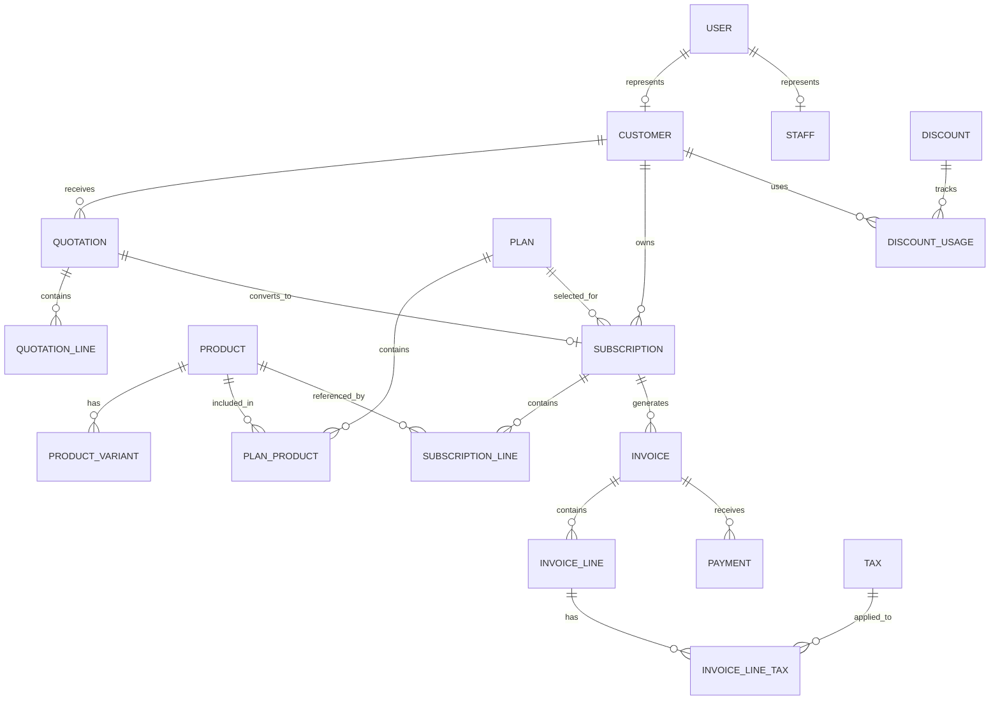

        # Database Schema — Subscription Management System

## 1. Database Overview

Database: PostgreSQL

ORM: Prisma

The system uses a relational database to maintain users, customers, products, subscription plans, quotations, subscriptions, invoices, discounts, taxes and payments.

All modules share the same PostgreSQL database.

## 2. Database Design Principles

- Use UUID primary keys for business entities.
- Use foreign keys to maintain referential integrity.
- Use unique constraints for email addresses and business identifiers.
- Use Decimal for all monetary values.
- Use timestamps for created and updated records.
- Use indexes on frequently queried fields.
- Avoid unnecessary duplication.
- Preserve historical financial information using snapshots.
- Use transactions for financial operations.
- Prefer soft deletion or archival for important business records.

## 3. Entity Relationship Overview

The diagram is conceptual. Final cardinalities and optional relationships must follow the approved Prisma schema.

## 4. User and Authentication Tables

### User

| Column | Type | Constraints |
|---|---|---|
| id | UUID | Primary Key |
| name | VARCHAR | Required |
| email | VARCHAR | Unique, Required |
| passwordHash | VARCHAR | Required |
| role | ENUM | ADMIN, STAFF, CUSTOMER |
| isActive | BOOLEAN | Default true |
| createdAt | TIMESTAMP | Required |
| updatedAt | TIMESTAMP | Required |

### PasswordResetToken

| Column | Type | Constraints |
|---|---|---|
| id | UUID | Primary Key |
| userId | UUID | Foreign Key |
| tokenHash | VARCHAR | Required |
| expiresAt | TIMESTAMP | Required |
| usedAt | TIMESTAMP | Nullable |
| createdAt | TIMESTAMP | Required |

Store only a hash of the reset token, not the raw token.

### Customer

| Column | Type | Constraints |
|---|---|---|
| id | UUID | Primary Key |
| userId | UUID | Unique Foreign Key |
| companyName | VARCHAR | Optional |
| phone | VARCHAR | Optional |
| address | TEXT | Optional |
| createdAt | TIMESTAMP | Required |
| updatedAt | TIMESTAMP | Required |

### Staff

| Column | Type | Constraints |
|---|---|---|
| id | UUID | Primary Key |
| userId | UUID | Unique Foreign Key |
| employeeCode | VARCHAR | Unique |
| createdAt | TIMESTAMP | Required |
| updatedAt | TIMESTAMP | Required |

A User has one role. Customer and Staff profiles are created only for their respective roles. Admin need not have either profile.

## 5. Product Management Tables

### Product

| Column | Type | Constraints |
|---|---|---|
| id | UUID | Primary Key |
| name | VARCHAR | Required |
| type | VARCHAR / ENUM | Required |
| salesPrice | DECIMAL | Required |
| costPrice | DECIMAL | Required |
| notes | TEXT | Optional |
| isActive | BOOLEAN | Default true |
| createdAt | TIMESTAMP | Required |
| updatedAt | TIMESTAMP | Required |

### ProductVariant

| Column | Type | Constraints |
|---|---|---|
| id | UUID | Primary Key |
| productId | UUID | Foreign Key |
| name | VARCHAR | Required |
| additionalPrice | DECIMAL | Default 0 |
| isActive | BOOLEAN | Default true |
| createdAt | TIMESTAMP | Required |

Price calculation:

`Final Unit Price = Base Sales Price + Variant Additional Price`

## 6. Subscription Plan Tables

### Plan

| Column | Type | Constraints |
|---|---|---|
| id | UUID | Primary Key |
| name | VARCHAR | Required |
| price | DECIMAL | Required |
| billingFrequency | ENUM | DAILY, WEEKLY, MONTHLY, YEARLY |
| minimumQuantity | INTEGER | Required |
| availableFrom | DATE | Required |
| availableUntil | DATE | Optional |
| autoClose | BOOLEAN | Default false |
| allowEarlyClose | BOOLEAN | Default true |
| allowPause | BOOLEAN | Default true |
| allowRenewal | BOOLEAN | Default true |
| isActive | BOOLEAN | Default true |
| createdAt | TIMESTAMP | Required |
| updatedAt | TIMESTAMP | Required |

### PlanProduct

| Column | Type | Constraints |
|---|---|---|
| id | UUID | Primary Key |
| planId | UUID | Foreign Key |
| productId | UUID | Foreign Key |
| defaultQuantity | INTEGER | Required |

The PlanProduct relationship supports plans containing one or more products. If the agreed business rules require exactly one product per plan, simplify this relationship accordingly.

## 7. Quotation Tables

### QuotationTemplate

| Column | Type | Constraints |
|---|---|---|
| id | UUID | Primary Key |
| name | VARCHAR | Required |
| validityDays | INTEGER | Required |
| isActive | BOOLEAN | Default true |
| createdAt | TIMESTAMP | Required |

### Quotation

| Column | Type | Constraints |
|---|---|---|
| id | UUID | Primary Key |
| quotationNumber | VARCHAR | Unique |
| customerId | UUID | Foreign Key |
| templateId | UUID | Optional Foreign Key |
| status | ENUM | DRAFT, SENT, ACCEPTED, REJECTED, EXPIRED |
| quotationDate | DATE | Required |
| validUntil | DATE | Required |
| paymentTerms | TEXT | Optional |
| subtotal | DECIMAL | Required |
| taxTotal | DECIMAL | Required |
| discountTotal | DECIMAL | Required |
| totalAmount | DECIMAL | Required |
| createdAt | TIMESTAMP | Required |

### QuotationLine

| Column | Type | Constraints |
|---|---|---|
| id | UUID | Primary Key |
| quotationId | UUID | Foreign Key |
| productId | UUID | Foreign Key |
| planId | UUID | Optional Foreign Key |
| quantity | INTEGER | Required |
| unitPrice | DECIMAL | Required |
| taxAmount | DECIMAL | Required |
| discountAmount | DECIMAL | Required |
| lineTotal | DECIMAL | Required |

## 8. Subscription Tables

### Subscription

| Column | Type | Constraints |
|---|---|---|
| id | UUID | Primary Key |
| subscriptionNumber | VARCHAR | Unique |
| customerId | UUID | Foreign Key |
| planId | UUID | Foreign Key |
| quotationId | UUID | Optional Unique Foreign Key |
| status | ENUM | DRAFT, QUOTATION, CONFIRMED, ACTIVE, CLOSED |
| startDate | DATE | Required |
| expiryDate | DATE | Optional |
| nextBillingDate | DATE | Optional |
| paymentTerms | TEXT | Optional |
| createdAt | TIMESTAMP | Required |
| updatedAt | TIMESTAMP | Required |

### SubscriptionLine

| Column | Type | Constraints |
|---|---|---|
| id | UUID | Primary Key |
| subscriptionId | UUID | Foreign Key |
| productId | UUID | Foreign Key |
| variantId | UUID | Optional Foreign Key |
| quantity | INTEGER | Required |
| unitPrice | DECIMAL | Required |
| taxAmount | DECIMAL | Required |
| discountAmount | DECIMAL | Required |
| lineTotal | DECIMAL | Required |

Pause/resume history and renewal history should be modeled using a separate event/history table if the implementation requires an auditable lifecycle.

## 9. Tax Tables

### Tax

| Column | Type | Constraints |
|---|---|---|
| id | UUID | Primary Key |
| name | VARCHAR | Required |
| rate | DECIMAL | Required |
| taxType | ENUM | PERCENTAGE, FIXED |
| isActive | BOOLEAN | Default true |
| createdAt | TIMESTAMP | Required |

### InvoiceLineTax

| Column | Type | Constraints |
|---|---|---|
| id | UUID | Primary Key |
| invoiceLineId | UUID | Foreign Key |
| taxId | UUID | Optional Foreign Key |
| taxNameSnapshot | VARCHAR | Required |
| taxRateSnapshot | DECIMAL | Required |
| taxAmount | DECIMAL | Required |

Tax jurisdiction, inclusive/exclusive calculation and rounding policy must be agreed before final implementation.

## 10. Discount Tables

### Discount

| Column | Type | Constraints |
|---|---|---|
| id | UUID | Primary Key |
| name | VARCHAR | Required |
| discountType | ENUM | FIXED, PERCENTAGE |
| discountValue | DECIMAL | Required |
| minimumPurchase | DECIMAL | Optional |
| minimumQuantity | INTEGER | Optional |
| startDate | DATE | Required |
| endDate | DATE | Required |
| usageLimit | INTEGER | Optional |
| usageCount | INTEGER | Default 0 |
| scope | ENUM | PRODUCT, SUBSCRIPTION |
| isActive | BOOLEAN | Default true |
| createdAt | TIMESTAMP | Required |

### DiscountProduct

| Column | Type | Constraints |
|---|---|---|
| id | UUID | Primary Key |
| discountId | UUID | Foreign Key |
| productId | UUID | Foreign Key |

### DiscountUsage

| Column | Type | Constraints |
|---|---|---|
| id | UUID | Primary Key |
| discountId | UUID | Foreign Key |
| customerId | UUID | Foreign Key |
| invoiceId | UUID | Optional Foreign Key |
| discountAmount | DECIMAL | Required |
| usedAt | TIMESTAMP | Required |

Discount usage must be updated transactionally to prevent exceeding limits.

## 11. Invoice Tables

### Invoice

| Column | Type | Constraints |
|---|---|---|
| id | UUID | Primary Key |
| invoiceNumber | VARCHAR | Unique |
| customerId | UUID | Foreign Key |
| subscriptionId | UUID | Foreign Key |
| billingPeriodStart | DATE | Required |
| billingPeriodEnd | DATE | Required |
| invoiceDate | DATE | Required |
| dueDate | DATE | Required |
| status | ENUM | DRAFT, CONFIRMED, PAID, CANCELLED |
| subtotal | DECIMAL | Required |
| taxTotal | DECIMAL | Required |
| discountTotal | DECIMAL | Required |
| totalAmount | DECIMAL | Required |
| amountPaid | DECIMAL | Default 0 |
| outstandingAmount | DECIMAL | Required |
| createdAt | TIMESTAMP | Required |

Recommended unique constraint:

`subscriptionId + billingPeriodStart + billingPeriodEnd`

This helps prevent duplicate recurring invoices. The exact policy for manually created invoices and adjustments must also be defined.

### InvoiceLine

| Column | Type | Constraints |
|---|---|---|
| id | UUID | Primary Key |
| invoiceId | UUID | Foreign Key |
| productId | UUID | Optional Foreign Key |
| productNameSnapshot | VARCHAR | Required |
| quantity | INTEGER | Required |
| unitPrice | DECIMAL | Required |
| taxAmount | DECIMAL | Required |
| discountAmount | DECIMAL | Required |
| lineTotal | DECIMAL | Required |

Invoice lines must retain historical product and pricing information even if the original product is later edited or archived.

## 12. Payment Tables

### Payment

| Column | Type | Constraints |
|---|---|---|
| id | UUID | Primary Key |
| invoiceId | UUID | Foreign Key |
| paymentMethod | ENUM / VARCHAR | Required |
| amount | DECIMAL | Required |
| paymentDate | TIMESTAMP | Required |
| note | TEXT | Optional |
| referenceNumber | VARCHAR | Optional |
| createdAt | TIMESTAMP | Required |

The initial system supports recording payments. Payment gateway integration is outside the mandatory scope.

## 13. Billing Job Tables

### BillingRun

| Column | Type | Constraints |
|---|---|---|
| id | UUID | Primary Key |
| startedAt | TIMESTAMP | Required |
| completedAt | TIMESTAMP | Optional |
| status | ENUM | RUNNING, COMPLETED, FAILED |
| processedCount | INTEGER | Default 0 |
| successCount | INTEGER | Default 0 |
| failureCount | INTEGER | Default 0 |
| errorSummary | TEXT | Optional |

### BillingRunItem

| Column | Type | Constraints |
|---|---|---|
| id | UUID | Primary Key |
| billingRunId | UUID | Foreign Key |
| subscriptionId | UUID | Foreign Key |
| invoiceId | UUID | Optional Foreign Key |
| status | ENUM | SUCCESS, FAILED, SKIPPED |
| errorMessage | TEXT | Optional |

Billing job records support retries, diagnostics and duplicate prevention.

## 14. Notification Tables

### Notification

| Column | Type | Constraints |
|---|---|---|
| id | UUID | Primary Key |
| userId | UUID | Optional Foreign Key |
| recipient | VARCHAR | Required |
| type | VARCHAR | Required |
| subject | VARCHAR | Required |
| status | ENUM | PENDING, SENT, FAILED |
| sentAt | TIMESTAMP | Optional |
| errorMessage | TEXT | Optional |
| createdAt | TIMESTAMP | Required |

This table supports notification history if notifications are implemented.

## 15. Important Database Relationships

- User has an optional Customer profile.
- User has an optional Staff profile.
- Customer can have multiple quotations.
- Customer can have multiple subscriptions.
- Product can have multiple variants.
- Plan can contain multiple products through PlanProduct.
- Quotation contains multiple quotation lines.
- Quotation may convert into a subscription.
- Subscription contains multiple subscription lines.
- Subscription can generate multiple invoices.
- Invoice contains multiple invoice lines.
- Invoice can receive multiple payments.
- Discounts can apply to eligible products or subscriptions.
- Invoice lines preserve tax and product snapshots.

## 16. Important Indexes

Recommended indexes:

- User.email — unique.
- Product.name.
- Product.isActive.
- Plan.billingFrequency.
- Subscription.subscriptionNumber — unique.
- Subscription.customerId.
- Subscription.status.
- Subscription.nextBillingDate.
- Quotation.quotationNumber — unique.
- Invoice.invoiceNumber — unique.
- Invoice.customerId.
- Invoice.status.
- Invoice.dueDate.
- Invoice.subscriptionId and billing period.
- Payment.invoiceId.
- Payment.paymentDate.
- Discount startDate/endDate.

## 17. Database Ownership and Migration Rules

The database is shared by both developers.

Developer A owns initial schema proposals for:
- Users
- Customers
- Staff
- Products
- Variants
- Plans
- Quotations
- Subscriptions
- Taxes
- Discounts

Developer B owns schema proposals for:
- Invoices
- Invoice lines
- Payments
- Billing runs
- Billing run items
- Notifications

Both developers must coordinate changes to shared entities and relationships.

One designated integrator is responsible for:
- Reviewing Prisma schema changes.
- Combining schema changes.
- Resolving relation conflicts.
- Generating and applying migrations in the agreed order.
- Verifying migrations against a clean database.

Never independently merge conflicting migration histories.

## 18. Important Implementation Notes

This document is a logical database blueprint, not an instruction to copy every table without review.

Before implementing Prisma models:
- Finalize optional and required relationships.
- Finalize enum values.
- Define monetary precision and scale.
- Define deletion and archival policies.
- Define billing timezone.
- Define tax calculation rules.
- Define payment overpayment policy.
- Define partial-payment behavior.
- Define invoice cancellation behavior.

## 19. Final Goal

The database must maintain reliable relationships between customers, products, plans, subscriptions, invoices, discounts and payments.

It must support thousands of subscriptions while maintaining data integrity, historical accuracy and efficient queries.